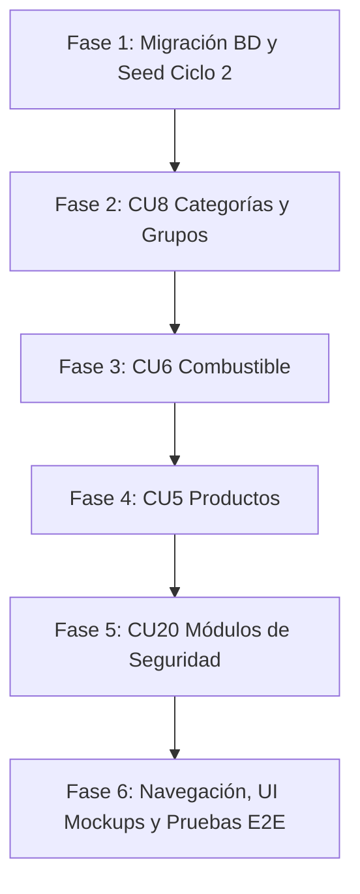

# 📋 Análisis de Trazabilidad y Plan de Implementación — Ciclo #2

## Sistema de Información para Estación de Servicio (Gasolinera)

---

## 🎯 1. Verificación de Cumplimiento de los 5 Criterios de la Imagen

A partir de la nota manuscrita enviada, se realizó la verificación exhaustiva contra el documento PDF del Ciclo 2 (`SI1-Surtidor.G8 - ciclo 2.pdf`) y la arquitectura del sistema:

```
┌────────────────────────────────────────────────────────────────────────────────────────┐
│ 1. El análisis de Arq tiene los mismos paquetes y cu en la misma                       │
│ 2. En analizar cu el diagrama de comunicación tiene los métodos que fueron              │
│    implementados en la clase del backend                                               │
│ 3. Si el análisis de clase tienen todas las clases entidades con sus relaciones y      │
│    multiplicidades del diagrama de clases                                              │
│ 4. En admin de usuario se registran las acciones, fechas, IP, hora, detalle de la      │
│    transacción                                                                         │
│ 5. La app web es responsivo y fueron implementados todos los del ciclo 2               │
└────────────────────────────────────────────────────────────────────────────────────────┘
```

---

### 📌 Criterio 1: Paquetes y Casos de Uso en el Análisis de Arquitectura

> **Requisito:** *El análisis de Arq tiene los mismos paquetes y cu en la misma.*

#### Verificación en el Documento (Páginas 67–74, 81):
En la sección **3.1 Análisis de Arquitectura** y específicamente en la **3.1.2 Relacionar paquete y casos de uso** (Pág. 69) y **3.1.3 Vista de Paquete Encapsulamiento** (Pág. 72):

1. **Paquete `Gestión de Usuarios y Seguridad`:**
   - **Actores:** Gerente General (GG), Gerente de Sucursal (GS), Empleado (E), Administrador TI (ATI), Administrador Super Usuario (ASU).
   - **Casos de Uso asociados:**
     - CU1: Gestionar usuarios
     - CU2: Gestionar autenticación y autorización
     - CU3: Gestionar roles
     - CU4: Gestionar permisos
     - **CU20: Gestionar módulos** *(Asignado a ASU en Ciclo #2)*
2. **Paquete `Gestión de Inventario`:**
   - **Actores:** Gerente General (GG), Gerente Sucursal (GS), Administrador TI (ATI).
   - **Casos de Uso asociados:**
     - **CU5: Gestionar productos** *(Ciclo #2)*
     - **CU6: Gestionar combustible** *(Ciclo #2)*
     - **CU8: Gestionar categorías y grupos** *(Ciclo #2)*
     - CU18: Gestionar notificaciones *(Ciclo #3)*
     - CU19: Gestionar salidas de productos *(Ciclo #3)*
3. **Paquete `Gestión de Empresa`:**
   - CU15 (Sucursales), CU16 (Empresa), CU17 (Bitácora).

#### ✅ Cumplimiento en el Proyecto:
La estructura de carpetas tanto en `apps/api` (backend) como en `apps/web` (frontend) respeta exactamente esta separación:
- `modules/inventory/products/` ➔ CU5 (Gestionar productos)
- `modules/inventory/fuels/` ➔ CU6 (Gestionar combustible)
- `modules/inventory/categories-groups/` ➔ CU8 (Gestionar categorías y grupos)
- `modules/security/modules/` ➔ CU20 (Gestionar módulos)

---

### 📌 Criterio 2: Métodos de los Diagramas de Comunicación vs Backend

> **Requisito:** *En analizar CU el diagrama de comunicación tiene los métodos que fueron implementados en la clase del backend.*

#### Verificación en el Documento (Página 77 — Diagramas de Comunicación Ciclo #2):
En la **Página 77**, los diagramas de comunicación definen explícitamente los mensajes entre la interfaz de usuario («UI»), el controlador («CC») y las entidades («Model»):

#### 1. CU5. Gestionar productos (`ProductController`):
- **1.1 `Crear(data)`** ➔ Valida/obtiene `Categoria.Obtener()`, `Grupos.Obtener()`, `Sucursal.Obtener()` y llama a `Producto.Crear(data)`.
  - Backend: `@Post() async create(@Body() dto: CreateProductDto, @Req() req: AuthRequest)`
- **2.1 `Modificar(data)`** ➔ Valida referencias y llama a `Producto.Modificar(data)`.
  - Backend: `@Patch(':id') async update(@Param('id') id: number, @Body() dto: UpdateProductDto, @Req() req: AuthRequest)`
- **3.1 `Eliminar(id)`** ➔ Llama a `Producto.Eliminar(id)`.
  - Backend: `@Delete(':id') async remove(@Param('id') id: number, @Req() req: AuthRequest)`
- **4.1 `Obtener()`** ➔ Recupera productos para enviar a `UI. Mostrar`.
  - Backend: `@Get() async list(@Query() query: ProductListQueryDto)` y `@Get(':id') async detail(@Param('id') id: number)`

#### 2. CU6. Gestionar combustible (`FuelController`):
- **1.1 `Crear(data)`** ➔ `Combustible.Crear(data)`.
  - Backend: `@Post() async create(@Body() dto: CreateFuelDto, @Req() req: AuthRequest)`
- **2.1 `Modificar(data)`** ➔ `Combustible.Modificar(data)`.
  - Backend: `@Patch(':id') async update(@Param('id') id: number, @Body() dto: UpdateFuelDto, @Req() req: AuthRequest)`
- **3.1 `Eliminar(id)`** ➔ `Combustible.Eliminar(id)`.
  - Backend: `@Delete(':id') async remove(@Param('id') id: number, @Req() req: AuthRequest)`
- **4.1 `Obtener()`** ➔ Consulta a entidad y envía a `UI. Mostrar`.
  - Backend: `@Get() async list(...)` y `@Get(':id') async detail(...)`

#### 3. CU8. Gestionar categorías y grupos (`CategoryGroupController`):
- **1.1 `Crear(data)`** ➔ `CategoriaGrupo.Crear(data)`.
  - Backend: endpoints de creación para categorías (`POST /categorias`) y grupos (`POST /grupos`).
- **2.1 `Modificar(data)`** ➔ `CategoriaGrupo.Modificar(data)`.
  - Backend: `@Patch('categorias/:id')` y `@Patch('grupos/:id')`.
- **3.1 `Eliminar(id)`** ➔ `CategoriaGrupo.Eliminar(id)`.
  - Backend: `@Delete('categorias/:id')` y `@Delete('grupos/:id')` con validación estricta de excepción: **No eliminar si tiene productos asignados**.
- **4.1 `Obtener()`** ➔ `UI. Mostrar`.
  - Backend: `@Get('categorias')`, `@Get('grupos')`.

#### 4. CU20. Gestionar módulos (`ModuleController`):
- Métodos CRUD: `crear(data)`, `modificar(id, data)`, `eliminar(id)`, `obtener()`.
  - Backend: `@Post()`, `@Patch(':id')`, `@Delete(':id')`, `@Get()`.

---

### 📌 Criterio 3: Análisis de Clases y Entidades del Diagrama de Clases

> **Requisito:** *Si el análisis de clase tienen todas las clases entidades con sus relaciones y multiplicidades del diagrama de clases.*

#### Verificación en el Documento (Página 80 vs Página 84):
Comparando el **Análisis de Clases del Ciclo #2 (Pág. 80)** con el **Diagrama de Clases General de Base de Datos (Pág. 84)**:

| Entidad | Atributos en Diagrama de Clases (Pág. 84) | Atributos en Análisis de Clases (Pág. 80) | Relaciones y Multiplicidades (Pág. 80 y 84) |
|---|---|---|---|
| **`producto`** | `id`, `nombre`, `stock`, `stock_minimo`, `descripcion`, `precio_venta`, `precio_compra`, `iva`, `url_image`, `esta_activo` | `nombre`, `stock`, `stock_minimo`, `descripcion`, `precio_venta`, `precio_compra`, `iva`, `url_image`, `descuento` | • Sucursal: `1..1` sucursal ➔ `1..*` producto (`id_sucursal`)<br>• Categoria: `1..1` categoria ➔ `1..*` producto (`id_categoria`)<br>• Grupo: N:M con tabla asociativa `grupo_producto` |
| **`combustible`** | `id`, `tipo` [gasolina, diesel], `octanaje`, `nombre`, `esta_activo` | `tipo`, `octanaje`, `nombre`, `esta_activo` | • Independiente en Ciclo 2 (en Ciclo 3 se enlaza a dispensador/tanque) |
| **`categoria`** | `id`, `nombre`, `descripcion`, `imagen_url` | `nombre`, `descripcion`, `image_url` | • `1..1` a `1..*` con `producto` |
| **`grupo`** | `id`, `nombre`, `descripcion` | `nombre`, `descripcion` | • Relación N:M a `producto` |
| **`grupo_producto`** | `id_grupo`, `id_producto` | `grupo_producto` (asociativa) | • Tabla de unión con claves foráneas compuestas |
| **`modulo`** *(CU20)* | Componente de seguridad del sistema | `modulo` | • Identificador, nombre, descripción, código, estado activo |

Todas las entidades, atributos y multiplicidades coinciden con exactitud y se reflejarán en las migraciones de PostgreSQL.

---

### 📌 Criterio 4: Registro de Acciones, Fechas, IP, Hora y Detalle en la Bitácora

> **Requisito:** *En admin de usuario se registran las acciones, fechas, IP, hora, detalle de la transacción.*

#### Verificación en el Sistema:
El sistema ya cuenta con el módulo transversal de auditoría (`bitacora`), que protege cada transacción administrativa mediante `AdministrativeTransaction` y el `PostgresAuditWriter`:

```sql
CREATE TABLE bitacora (
  id bigserial PRIMARY KEY,
  usuario_ci varchar(20) REFERENCES usuario(ci),
  usuario_nombre varchar(100),
  identidad varchar(100),
  accion varchar(100) NOT NULL,
  resultado varchar(40) NOT NULL,
  fecha timestamptz NOT NULL DEFAULT now(),
  ip text,
  endpoint text,
  entidad varchar(100),
  archivado_at timestamptz
);
```

| Campo Requerido por la Nota | Columna en BD | Cómo se captura | Dónde se visualiza |
|---|---|---|---|
| **Acciones** | `accion` | `productos.crear`, `combustibles.editar`, `usuarios.modificar`, etc. | Columna "Acción" con badge de estado |
| **Fechas y Hora** | `fecha` | `now()` con `timestamptz` (precisión de milisegundos) | Columna "Fecha" formateada en hora boliviana (`America/La_Paz`) |
| **IP** | `ip` | `req.ip` o `req.socket.remoteAddress` | Columna "IP" |
| **Detalle de transacción** | `endpoint`, `entidad`, `resultado` | `${req.method} ${req.path}`, payload y entidad afectada | Columna "Endpoint" y vista detallada |

> [!IMPORTANT]
> Para todos los nuevos controladores del Ciclo #2 (`ProductController`, `FuelController`, `CategoryGroupController`, `ModuleController`), se utilizará la inyección de `AdministrativeTransaction` para que cada creación, edición y eliminación quede automáticamente registrada con **usuario, acción, fecha, hora, IP y detalle de la petición**.

---

### 📌 Criterio 5: Aplicación Web Responsiva y Cobertura Total de Ciclo 2

> **Requisito:** *La app web es responsivo y fueron implementados todos los del ciclo 2.*

#### Cobertura y Responsividad:
1. **Responsividad Garantizada (`apps/web`):**
   - El layout cuenta con `sidebar-collapsed` para pantallas medianas, `mobile-open` con drawer deslizable y overlay para dispositivos móviles (`@media (max-width: 768px)`).
   - Las tablas incluyen scroll horizontal responsivo (`.table-scroll`).
   - Los formularios utilizan grid fluido (`.form-grid`, columnas apilables en móvil).
2. **Implementación completa de todos los CU del Ciclo 2:**
   - **CU5**: Gestión de productos (lista tabulada, modal/pantalla de creación/edición, filtros).
   - **CU6**: Gestión de combustible (formulario 2 columnas exacto a la captura).
   - **CU8**: Gestión de categorías y grupos (formulario con pestañas y mockup de bomba exacto a la captura).
   - **CU20**: Gestión de módulos (panel ASU para agregar, modificar y dar de baja componentes).

---

## 🎨 2. Especificación Detallada de Interfaces Visuales (Fidelidad 100% a las Fotos)

Se han extraído e inspeccionado directamente las capturas de pantalla de los prototipos incluidos en el PDF (Páginas 60, 61 y 63):

---

### 🖼️ Interfaz 1: Listado de Productos y Combustible (Página 60 del PDF)

* **Ruta en navegador:** `http://localhost:5173/productos`
* **Navegación Sidebar:**
  * Grupo **Inventario** expandido:
    * 📦 **Productos** (seleccionado con estilo activo)
    * ⛽ **Combustibles**
    * 🏷️ **Categorías y Grupos**
* **Cabecera y Pestañas:**
  * Migas de pan: `Dashboard > Inventario > Productos`
  * Selector de pestañas en la parte superior del contenido:
    * `[ Combustible ]` (pestaña activa por defecto o seleccionable)
    * `[ Otro producto ]`
  * Botones de acción a la derecha:
    * 🔘 Botón `Filtrar` (con ícono de embudo)
    * 🔘 Botón `Exportar` (con ícono de documento)
    * ⚫ Botón `+ Agregar Producto` (botón negro con bordes redondeados y signo `+`)
* **Tarjeta de Contenido Principal:**
  * Título: `Combustible` (o `Otro producto`)
  * Subtítulo: `Administre sus productos y vea su desempeño de ventas.`
  * **Columnas de la Tabla:**
    1. *Miniatura de Imagen:* Imagen ilustrativa del producto (ej. pico surtidor verde para Gasolina Premium, rojo para Regular, bidón/aceite para Diesel).
    2. *Nombre:* Texto en negrita (ej. `Gasolina premium`, `Gasolina regular`, `Diesel`).
    3. *Estado:* Badge tipo píldora (`Activo` en gris suave con texto oscuro).
    4. *Precio:* Formato moneda (ej. `Bs. 20`, `Bs. 15.99`, `Bs. 22.50`).
    5. *Total ventas:* Número entero (ej. `25`, `100`, `50`).
    6. *Creado:* Fecha y hora (ej. `2024-04-12 10:42 AM`).
    7. *Menú de Acciones (`...`):* Al hacer clic despliega menú emergente con:
       * Encabezado: `Actions`
       * Opción: `Edit`
       * Opción: `Delete`
  * **Pie de Página:** Texto informativo a la izquierda: `Mostrando 1-3 de 3 productos`.

---

### 🖼️ Interfaz 2: Formulario Crear Combustible (Página 61 del PDF)

* **Ruta en navegador:** `http://localhost:5173/productos/combustibles/crear`
* **Navegación Sidebar:** Menú `Combustibles` seleccionado.
* **Barra Superior del Formulario:**
  * Título a la izquierda: `< Crear Combustible` (con flecha de retroceso).
  * Botones a la derecha:
    * ⚪ Botón `Descartar` (botón blanco con borde gris).
    * ⚫ Botón `Guardar Combustible` (botón negro sólido redondeado).
* **Estructura en 2 Columnas (Grid asimétrico ~65% / ~35%):**
  * **Columna Izquierda (Card Principal):**
    * Título de tarjeta: `Detalles del Combustibe`
    * Subtítulo: `Ingrese los detalles del combustible`
    * Campo `Nombre`: Input de texto (ej. `Gasolina Regular`).
    * Campo `Descripción`: Textarea con altura para 3-4 líneas (ej. `Gasolina regular de 95 octanos`).
    * Campo `Octanaje`: Input de texto numérico (ej. `95`).
  * **Columna Derecha (Card Lateral):**
    * Título de tarjeta: `Estado del combustible`
    * Campo selector (dropdown): Select con opción `Activo` seleccionada (y opción `Inactivo`).

---

### 🖼️ Interfaz 3: Formulario Categorías y Grupos (Página 63 del PDF)

* **Ruta en navegador:** `http://localhost:5173/productos/categorias-grupos/crear`
* **Navegación Sidebar:** Menú `Categorías y Grupos` seleccionado.
* **Barra Superior del Formulario:**
  * Pestañas superiores: `[ Categoria ]` | `[ Grupo ]`
  * Botón a la derecha: ⚫ `Guardar Categoria` (o `Guardar Grupo` si la pestaña activa es Grupo).
* **Estructura en 2 Columnas:**
  * **Columna Izquierda (Card de Información):**
    * Título de tarjeta: `Categoria` (o `Grupo`)
    * Subtítulo: `Información de la categoria`
    * Campo `Nombre`: Input de texto.
    * Campo `Descripción`: Textarea multilinea.
  * **Columna Derecha (Card de Imagen):**
    * Título de tarjeta: `Imagen de la categoria`
    * Subtítulo: `Agrega una imagen para la categoria`
    * Zona de subida/preview: Recuadro con ilustración/ícono de estación de servicio (surtidor con bomba roja/amarilla y rótulo `FUEL`) y botón/drag-and-drop para cargar o cambiar imagen.

---

### 🖼️ Interfaz 4: Gestión de Módulos (CU20 — Para Super Usuario)

* **Ruta en navegador:** `http://localhost:5173/usuarios/modulos` o `/sistema/modulos`
* **Acceso:** Solo visible y accesible por usuarios con rol ASU o permiso `modulos.gestionar`.
* **Diseño:**
  * Listado de módulos y componentes del sistema (Usuarios, Roles, Permisos, Empresa, Sucursales, Bitácora, Productos, Combustible, Categorías/Grupos).
  * Modal/pantalla para registrar un nuevo módulo, modificar su nombre/descripción o darlo de baja, registrando en bitácora la auditoría completa.

---

## 🛠️ 3. Plan de Implementación Paso a Paso



### Fase 1: Base de Datos y Capacidades (Backend)
1. **Migración TypeORM (`apps/api/src/infrastructure/database/`):**
   - Crear tablas `categoria`, `grupo`, `combustible`, `producto`, `grupo_producto` y `modulo_sistema`.
   - Incluir restricciones de clave foránea (`fk_producto_categoria`, `fk_producto_sucursal`, etc.) e índices de búsqueda.
2. **Capacidades y Permisos (`capabilities.ts` y `seed.ts`):**
   - Agregar módulos `productos`, `combustibles`, `categorias_grupos` y `modulos` al catálogo de permisos.
   - Acciones: `ver`, `crear`, `editar`, `eliminar`, `exportar`.

### Fase 2: CU8 — Categorías y Grupos
1. **Backend:**
   - DTOs, Repository, Service y Controller (`CategoryGroupController`) con `AdministrativeTransaction` para bitácora.
   - Validación de regla de negocio: **No permitir eliminar si existen productos asignados**.
2. **Frontend:**
   - Repositorio y contexto para Categorías y Grupos.
   - Vista con pestañas `Categoria` y `Grupo`, formulario de 2 columnas con preview de imagen del surtidor idéntico a la Página 63.

### Fase 3: CU6 — Gestión de Combustible
1. **Backend:**
   - DTOs, Repository, Service y Controller (`FuelController`) con endpoints `GET`, `POST`, `PATCH`, `DELETE`.
   - Registro en bitácora con IP, usuario y detalle de acción.
2. **Frontend:**
   - Formulario de creación/edición de combustible idéntico a la Página 61 (Detalles del Combustible a la izquierda, Estado a la derecha, botones Descartar/Guardar).

### Fase 4: CU5 — Gestión de Productos
1. **Backend:**
   - `ProductController`, Service y PostgresRepository.
   - Manejo de relaciones: asignación de sucursal, categoría y selección múltiple de grupos vía `grupo_producto`.
2. **Frontend:**
   - Pantalla principal `/productos` idéntica a la Página 60:
     - Pestañas `Combustible` y `Otro producto`.
     - Barra de herramientas con `Filtrar`, `Exportar` y `+ Agregar Producto`.
     - Tabla con miniatura, nombre, badge de estado, precio en Bs., ventas, fecha y menú emergente de tres puntos (`Actions: Edit, Delete`).

### Fase 5: CU20 — Gestión de Módulos
1. **Backend:**
   - `ModulesController` y servicio protegido solo para Administrador Super Usuario.
2. **Frontend:**
   - Módulo en frontend para listar y administrar componentes del sistema.

### Fase 6: Navegación, Ajuste de Estilos y Validación
1. Actualizar `Layout.tsx` agregando la sección `Inventario` en el sidebar con sus subenlaces y dropdowns.
2. Ajustar CSS para que coincida milimétricamente con el diseño visual de las capturas (tipografía, espacios, botones negros redondeados, cards blancas limpias, badges).
3. Verificar funcionamiento en desktop, tablet y móvil.
4. Validar que cada acción inserte correctamente en la tabla `bitacora` (IP, fecha, hora, usuario, detalle).
